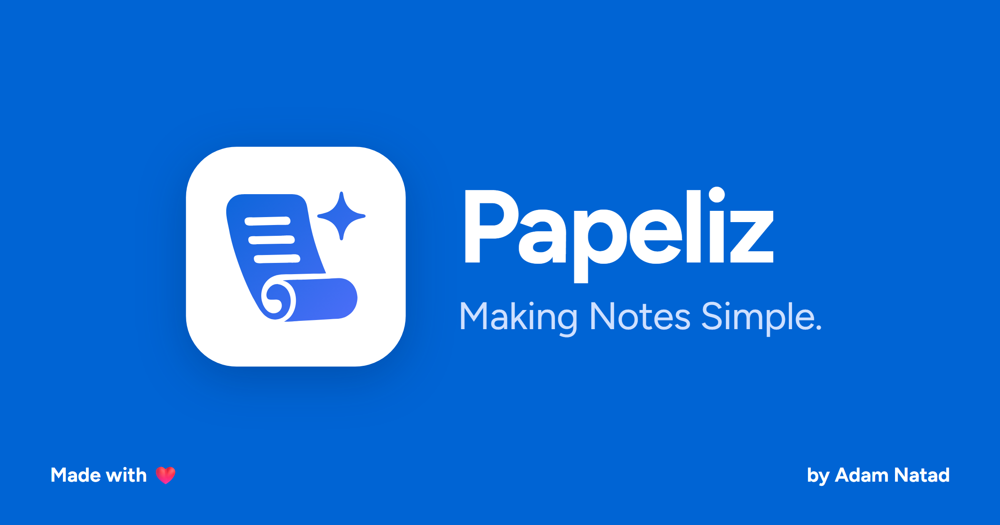
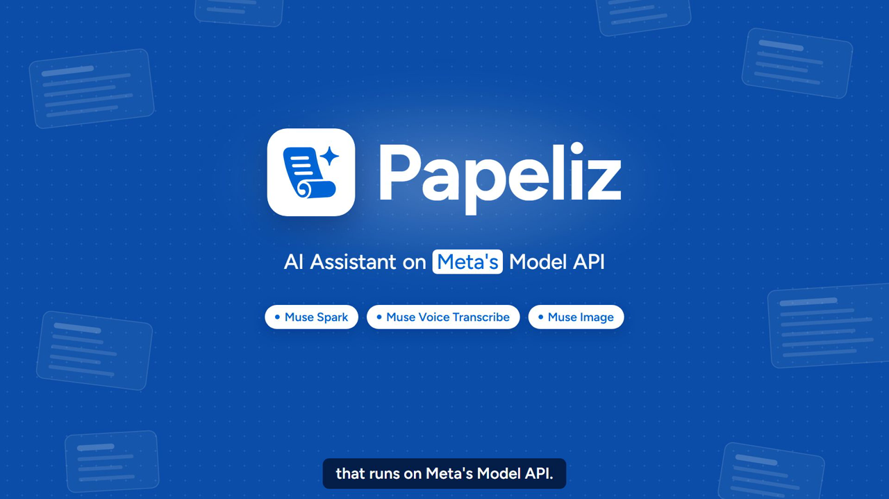
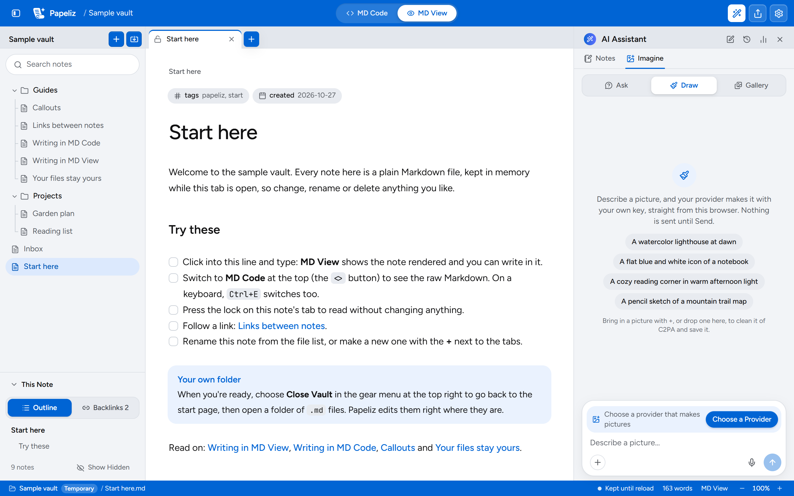
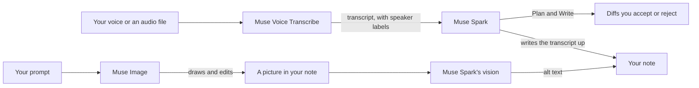
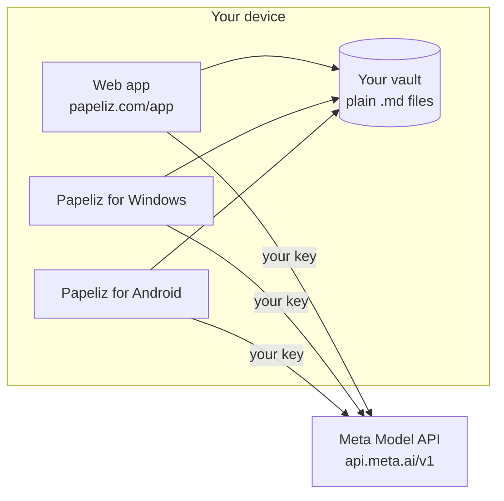

<p align="center">
  <a href="https://papeliz.com">
    
  </a>
</p>

<h1 align="center">Papeliz - Making Notes Simple.</h1>

<p align="center">
  Papeliz is a Free, Open-Source Markdown Editor for building your Personal Knowledge Base, with a built-in AI
  Assistant that works with your Preferred AI Provider, as well as the ability to create and import Workflow Templates
  for Coding and AI Agents.
</p>

<p align="center">
  <a href="LICENSE"></a>
  <a href="https://papeliz.com"></a>
  <a href="https://papeliz.com/app/"></a>
  <a href="https://dev.meta.ai/docs/quickstart"></a>
</p>

<p align="center">
  Developed on and for the <strong>Meta Global AI Developer Hackathon 2026</strong>.<br />
  <a href="https://papeliz.com/adam-natad/">Adam Natad</a> built the MVP in under 24 hours.
</p>

<p align="center">
  <a href="https://papeliz.com"><strong>Website</strong></a> ·
  <a href="https://papeliz.com/app/"><strong>Open the app</strong></a> ·
  <a href="https://papeliz.com/help/"><strong>Help</strong></a> ·
  <a href="CHANGELOG.md"><strong>Changelog</strong></a>
</p>

## Demo video (3 minutes)

<p align="center">
  <a href="https://youtu.be/I-rF_Y-SpHY">
    
  </a>
</p>

<p align="center">
  <a href="https://youtu.be/I-rF_Y-SpHY"><strong>▶ Watch the demo on YouTube</strong></a>
</p>

| Time | Part |
| --- | --- |
| 0:00 | Intro |
| 0:10 | Your vault |
| 0:24 | Templates |
| 0:39 | Ask, Plan and Write |
| 1:36 | Talk instead of typing |
| 2:04 | Imagine |
| 2:34 | Desktop |
| 2:43 | Close |

<p align="center">
  
</p>

## Try it in 60 seconds

1. Open **[papeliz.com/app](https://papeliz.com/app/)**. Nothing to install, no sign-up.
2. Choose **Templates** and start a vault from **P1-Workflow**, a workflow template for coding agents, or choose
   **Try Sample**.
3. Open the gear's **AI Provider**, pick the **Meta Model API** and paste your key from the
   [Model API dashboard](https://dev.meta.ai/).

Then try, in this order:

- **Plan, then Build** (Muse Spark). In the AI Assistant, choose **Plan** and describe a change. Edit the steps on the
  plan card, then press **Build**: the assistant moves to Write and proposes each step as a diff you accept or reject.
- **Ask across the vault** (Muse Spark). Choose **Ask** and ask what's left to do. The answer cites your notes as
  links.
- **Talk instead of typing** (Muse Voice Transcribe). Press the mic in the chat box and say your next step.
- **Imagine** (Muse Image). Draw a picture in the shape you pick and put it in a note. **Describe Picture** then
  writes its alt text with Muse Spark's vision.

## The problem, and who it's for

Where coders plan with Muse Spark, review every change as a diff, and keep it all in plain Markdown files.

**Software engineers and coders working with agentic workflows.** AI coding agents work from Markdown: agent
instructions, plans, specs and task lists. That work needs a home where the person reads it, plans it and approves
every change before an agent acts on it. Papeliz gives them:

- **Workflow Templates for coding and AI agents.** Start a vault from a template shared on GitHub. Every script it
  contains is listed, with **View Code** to read it, before the vault is made. Papeliz never runs them.
- **Ask, Plan and Write on Muse Spark across the whole vault.** Every edit arrives as a diff they accept or reject.
- **A plan said out loud.** Muse Voice Transcribe turns speech into text when they're too tired to type.
- **Plain files.** Notes are `.md` files in their own folder, so they stay in their Git.

Papeliz also serves students and writers building a knowledge base, and people who would rather speak than type.

**Theme: Build for Your World.** Papeliz is an everyday tool for the plans and notes people build with AI agents,
kept private and in plain files.

## Built on Meta's models

Papeliz's AI Assistant is built on the Meta Model API. Every request goes from your browser, or from Papeliz for
Windows or Android, straight to `https://api.meta.ai/v1` with your own key. Papeliz has no server in between.

| Meta model | What it does in Papeliz | Endpoint |
| --- | --- | --- |
| `muse-spark-1.3` | The assistant's Ask, Plan and Write across your whole vault; Rewrite, Shorter, Fix Grammar and Translate on a selection; Suggest Links and Suggest Tags; talking a picture over in Imagine's Ask; writing up a transcript | `POST /v1/chat/completions`, streamed |
| `muse-spark-1.3` (vision) | Describe Picture: alt text for a picture in a note | `POST /v1/chat/completions`, with the picture as `image_url` |
| `muse-voice-transcribe-1.0` | The one-press mic in every assistant box, and Transcribe for recordings and audio files, with speaker labels | `POST /v1/asr/transcribe` |
| `muse-image-1.0` | Imagine's Draw, in the shape you pick; Imagine from a selection in a note | `POST /v1/images/generations` |
| `muse-image-1.0` | Edit Picture: changes a picture in a note as you ask | `POST /v1/images/edits` |



### Beyond a basic integration

- **Three models, chained.** Speech goes to Muse Voice Transcribe and its transcript to Muse Spark, which writes it
  up for the note. A picture Muse Image draws can then be described by Muse Spark's vision.
  [`papeliz-assistant-inline-media-store.ts`](app/web/src/modules/assistant/papeliz-assistant-inline-media-store.ts)
- **Vision for accessibility.** Describe Picture writes a picture's alt text with Muse Spark's vision, as a change to
  accept. [`papeliz-assistant-inline-media-store.ts`](app/web/src/modules/assistant/papeliz-assistant-inline-media-store.ts)
- **About a million tokens of context.** Muse Spark's 1,048,576-token window lets the assistant read across a vault,
  and a ring beside the model chip shows how much is used.
  [`papeliz-assistant-provider-presets.ts`](app/web/src/modules/assistant/papeliz-assistant-provider-presets.ts)
- **A plan built step by step.** Plan writes steps you edit; Build saves them as a checklist note and runs each step
  in Write, as diffs you review, ticking the note as it goes.
  [`papeliz-assistant-plan-document.ts`](app/web/src/modules/assistant/papeliz-assistant-plan-document.ts),
  [`papeliz-assistant-conversation-store.ts`](app/web/src/modules/assistant/papeliz-assistant-conversation-store.ts)
- **A model for each task.** Transcribe and Draw each have their own model, apart from the chat's, with the Meta
  Model API's listed first.
  [`papeliz-assistant-media-model-choices-store.ts`](app/web/src/modules/assistant/papeliz-assistant-media-model-choices-store.ts)

Where the calls live:

- [`papeliz-assistant-provider-presets.ts`](app/web/src/modules/assistant/papeliz-assistant-provider-presets.ts):
  the Meta Model API preset, first in the list, with the Muse Spark models.
- [`papeliz-assistant-media-provider-presets.ts`](app/web/src/modules/assistant/papeliz-assistant-media-provider-presets.ts):
  Muse Image's shapes, and Muse Voice Transcribe's audio: 16-bit mono WAV, sent in pieces of under 10 minutes.
- [`papeliz-assistant-image-and-audio-client.ts`](app/web/src/modules/assistant/papeliz-assistant-image-and-audio-client.ts):
  the calls to `/images/generations`, `/images/edits` and `/asr/transcribe`.
- [`papeliz-openai-compatible-client.ts`](app/web/src/modules/assistant/papeliz-openai-compatible-client.ts):
  the streamed calls to `/chat/completions`.

## Features

Every model call below goes through the Meta Model API by default, with your own key. Papeliz also works with the
other providers you pick in Settings.

**AI Assistant** (Muse Spark)

- **Ask, Plan or Write:** look things up, get a plan you can save or build, or let it propose changes. Building a plan
  moves the assistant to Write.
- **It asks before guessing:** up to four questions on one card; pick an answer or write your own, then Next.
- **Steer it while it answers,** or queue your next message, and choose how much effort it spends.
- **Add files and pictures** to the chat.
- **Suggest Links and Suggest Tags:** wikilinks and tags across your notes, as diffs.
- **Rewrite, Shorter, Fix Grammar and Translate** a selection in place.
- **Edits stay in your hands:** proposals arrive as diffs, and deleted notes go to the vault's `.trash/` folder. Your
  saved chats are never touched.
- **Usage and cost:** tokens and cost for each model you use.

**Voice** (Muse Voice Transcribe)

- **A one-press mic** in every assistant box puts what you say into the message.
- **Transcribe** turns a recording or an audio file into text, with speaker labels, and Muse Spark writes it up into
  your note.

**Imagine** (Muse Image, and Muse Spark's vision)

- **Talk a picture over** with Muse Spark, **draw it** with Muse Image in the shape you pick, keep every picture in a
  gallery, and put one in a note.
- **Edit Picture** changes a picture with Muse Image, and **Describe Picture** writes its alt text with Muse Spark's
  vision.
- **Remove Metadata,** on by default, takes a picture's metadata out in your browser before it's saved.

**Write and organize**

- **MD Code and MD View behind one switch:** raw Markdown with syntax colors and line numbers, or the rendered note
  you can still type in.
- **Tables and diagrams:** Markdown tables and every Mermaid diagram type, in light and dark.
- **Pictures and video:** pictures from your vault or the web, `.mp4` and `.webm` videos, and YouTube links that load
  nothing until you press play.
- **Linked notes:** wikilinks (`[[note]]`), backlinks, an outline and full-text search.
- **Vaults your way:** a folder on your disk, or a vault kept in your browser that downloads as a `.zip`. Standard, or
  End-to-end: encrypted on your device behind a passphrase only you know.
- **Focus mode** (`Ctrl+Shift+F`): only your note and a floating prompt box.

**Export**

- **Word:** an editable `.docx` per note, with its tables, callouts, footnotes, pictures and diagrams.
- **PDF:** written by Papeliz itself. Text stays searchable, links work and headings become bookmarks.
- **HTML:** one note as a web page, or several as a small website in a `.zip`.
- **Template:** share notes you choose as a template for others to start from.

**Templates**

- **Start from a template,** or import one into the vault you have open, in a folder of its own.
- **Preview** every file first, with **View Code** for its text.
- **Contains Scripts:** a template with scripts or agent commands lists every one, with **View Code**, before the
  vault is made. Papeliz never runs them.

## How it's built



- **One app everywhere.** The web app is React and TypeScript. Papeliz for Windows and Android run the same app in a
  small native shell, so every platform shares one codebase.
- **No Papeliz server.** papeliz.com is static files. Requests go straight from the device to the provider, with the
  person's own key.
- **The Meta Model API's own shapes.** Streamed chat on `/chat/completions`, speech on the multipart
  `/asr/transcribe`, and pictures on `/images/generations` and `/images/edits`. Audio is turned into WAV on the
  device and sent in pieces.
- **Diffs, not overwrites.** Every model edit is a proposal you accept. The same note open twice merges line by line,
  and a clash asks what to keep.
- **Tested.** 1,219 unit tests and 90 browser tests, as of 2026-11-05.

How the pieces fit together: [docs/how-papeliz-is-built.md](docs/how-papeliz-is-built.md).

## Privacy and security

- **No Papeliz server.** papeliz.com is served as static files, with no code running on a server: no backend, no
  account, no analytics on your notes.
- **Notes stay on your device.** Papeliz reads and writes the folder you open (on the web, through the File System
  Access API). It never writes inside a vault's hidden folders, and deleted notes go to the vault's `.trash/` folder.
- **You choose what the assistant sees.** Each message shows which notes are shared with your provider, and nothing
  is sent until you send it.
- **Safe rendering.** Notes are sanitized before display, and the app ships a strict Content-Security-Policy, so a
  note can't run code in the page that holds your keys.

## Platforms and downloads

- **Web:** live at [papeliz.com/app](https://papeliz.com/app/), in any modern browser.
- **Papeliz for Windows and Papeliz for Android, 1.0.0 Preview 1:** download the Windows installer or the Android APK
  from the [release page](https://github.com/AdamNatad/Papeliz/releases/tag/v1.0.0-preview.1), with SHA-256
  checksums.

The Windows installer isn't code-signed yet, so Windows may show "Windows protected your PC". Choose **More info**,
then **Run anyway**.

| Browser | Support |
| --- | --- |
| Chrome, Edge (103 and later) | Open real folders on your disk, or keep a vault in the browser |
| Firefox (113 and later), Safari (16.4 and later), phones | Keep vaults in the browser, with backups |

## Other AI providers

Papeliz speaks the OpenAI-compatible API format, so one connection works with many providers. Pick a preset or enter
any compatible URL, paste your key, choose a model, and test it.

| Kind | Providers |
| --- | --- |
| Hosted | OpenAI, OpenRouter, Groq, Together, Fireworks, Google Gemini (OpenAI-compatible endpoint) |
| On your computer | Ollama, LM Studio (allow `https://papeliz.com` in their browser settings) |
| Anything else | Custom base URL for any OpenAI-compatible API |

Your key is stored only on your device and is sent only to the provider you picked.

## Roadmap

**Available now**

- [x] Folder vaults, browser vaults and End-to-end vaults
- [x] MD Code and MD View, tables, Mermaid diagrams, pictures and video
- [x] Export as Word, PDF, HTML and Template
- [x] The assistant's Ask, Plan and Write on Muse Spark, with every edit a diff
- [x] Imagine, Edit Picture and Describe Picture with Muse Image and Muse Spark's vision
- [x] The one-press mic and Transcribe with Muse Voice Transcribe
- [x] Workflow Templates, with every script shown before the vault is made

**Up next: Papeliz Sync**

- [ ] Keep your vaults in sync across web, desktop and mobile, with End-to-end encryption for the vaults you choose

**Later**

- [ ] Graph view and canvas
- [ ] Translations
- [ ] Math and code highlighting in MD View

## Run it locally

You need [Node.js](https://nodejs.org) 24 LTS and [pnpm](https://pnpm.io) (the version in `package.json`,
`packageManager`; `corepack enable` sets it up).

```bash
pnpm install
pnpm webapp:dev
```

The app opens at `http://127.0.0.1:14201`. The `webapp:*`, `site:*` and `help:*` scripts build, test, lint and
type-check each piece, and `pnpm deploy:assemble` builds everything for hosting.

## Built with

| Project | Used for | License |
| --- | --- | --- |
| [Vite](https://vite.dev) | Build and dev server | MIT |
| [React](https://react.dev) | User interface | MIT |
| [TypeScript](https://www.typescriptlang.org) | Language | Apache-2.0 |
| [Tailwind CSS](https://tailwindcss.com) | Styling | MIT |
| [CodeMirror](https://codemirror.net) | MD Code | MIT |
| [unified](https://unifiedjs.com) (remark, rehype) | Parsing and rendering Markdown | MIT |
| [Mermaid](https://mermaid.js.org) | Diagrams in MD View | MIT |
| [docx](https://docx.js.org) | Word export | MIT |
| [PDFKit](https://pdfkit.org) | PDF export | MIT |
| [bidi-js](https://github.com/lojjic/bidi-js) | Right-to-left text in PDFs | MIT |
| [MiniSearch](https://lucaong.github.io/minisearch/) | Full-text search | MIT |
| [zustand](https://zustand.docs.pmnd.rs) | App state | MIT |
| [Lucide](https://lucide.dev) | Icons | ISC |
| [Next.js](https://nextjs.org) | The website and help site (static export) | MIT |
| [Figtree](https://fonts.google.com/specimen/Figtree) via [Fontsource](https://fontsource.org) | Typeface | OFL-1.1 |
| [Charis SIL](https://software.sil.org/charis/) and [Noto Sans](https://fonts.google.com/noto/specimen/Noto+Sans) via Fontsource | Serif notes and other scripts in PDFs | OFL-1.1 |

Hosted on [Cloudflare Workers](https://workers.cloudflare.com) static assets.

## License

Made by [Adam Natad](https://papeliz.com/adam-natad/). [MIT](LICENSE) © 2026
[Natad Corporation](https://natad.ai/).

Issues and pull requests are welcome: keep notes as plain Markdown, never add a server that sees users' keys or
notes, and contribute only code you have the right to share under the MIT License.
