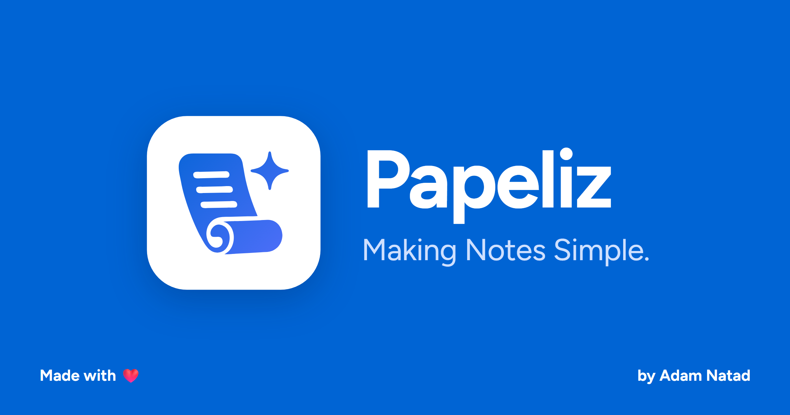

<p align="center">
  <a href="https://papeliz.com">
    
  </a>
</p>

<h1 align="center">Papeliz</h1>

<p align="center"><strong>Making Notes Simple.</strong></p>

<p align="center">
  <a href="https://papeliz.com"><strong>Website</strong></a> ·
  <a href="https://papeliz.com/app/"><strong>Open the app</strong></a> ·
  <a href="https://papeliz.com/help/"><strong>Help</strong></a> ·
  <a href="CHANGELOG.md"><strong>Changelog</strong></a>
</p>

<p align="center">
  <a href="LICENSE"></a>
  <a href="https://papeliz.com"></a>
  <a href="https://papeliz.com/app/"></a>
</p>

<p align="center">
  Developed on and for the <strong>Meta Global AI Developer Hackathon 2026</strong>.<br />
  <a href="https://papeliz.com/adam-natad/">Adam Natad</a> built the MVP in under 24 hours.
</p>

Papeliz is a free, open-source, cross-platform Markdown editor and AI-powered note-taking app for
building your personal knowledge base. Create, edit, organize, and connect your notes and ideas in
MD Code and MD View, with a built-in AI assistant that runs on your own API key — no account, and
no Papeliz server in between. Available on the web, Windows, macOS, Linux, Android, iOS, and
HarmonyOS.

**Try it now at [papeliz.com/app](https://papeliz.com/app/)** — open a folder of notes, keep a
vault in your browser, or start with the sample vault. Nothing to install, no sign-up.

## Why Papeliz

- **Your files stay yours.** Notes are plain `.md` files in a folder on your disk, or in a vault
  kept in your browser that downloads as a `.zip` of the same files. No proprietary format, no
  lock-in. Existing Markdown folders open as they are.
- **Use it anywhere, no account.** Open a folder of notes and start writing.
- **Your key, your provider.** The assistant talks straight from your device to the AI provider
  you choose. Papeliz has no server, so it never sees your key or your notes.
- **An assistant that works with you.** It answers questions about your notes, plans changes, and
  proposes edits as diffs you accept or reject. Nothing changes until you say so.
- **Free and open source.** MIT licensed.

## What you can do

**Write and organize**

- **MD Code and MD View behind one switch:** raw Markdown with syntax colors and line numbers, or
  the rendered note you can still type in.
- **Tables and diagrams:** Markdown tables and every Mermaid diagram type (flowcharts, sequence
  diagrams, charts and more) show drawn in MD View, in light and dark; click one to edit its source.
- **Linked notes:** wikilinks (`[[note]]`), backlinks, an outline and full-text search.
- **A file list you can make your own:** colors and icons for any note or folder.
- **Focus mode** (`Ctrl+Shift+F`): only your note and a floating prompt box.
- **Export as Word:** an editable `.docx` per note, with its tables, callouts, footnotes, pictures
  and diagrams; several notes come as one `.zip` whose links open each other. Google Docs and
  Notion open the same file.
- **Export as HTML:** one note as a single web page, or several as a small website in a `.zip`,
  with a Markdown twin of every page and the site's Astro project to change and rebuild.
- **One Settings gear:** accessibility, key bindings, export, locking, focus mode and closing the
  vault, in one panel.

**Work with the AI assistant**

- **Ask, Plan or Write:** look things up, get a plan you can save or carry out, or let it propose
  changes.
- **It asks before guessing:** up to four questions on one card; pick an answer or write your own,
  then Next.
- **Steer it while it answers,** or queue your next message, and choose how much effort it spends.
- **Add files and pictures** to the chat.
- **Edits stay in your hands:** proposals arrive as diffs, inline edits change a selection in
  place, and deleted notes go to the vault's `.trash/` folder. Your saved chats are never touched.
- **Usage and cost:** tokens and cost for each model you use.

**Edit safely, anywhere**

- **The same note open in two tabs or apps:** changes are combined line by line when you save; if
  both changed the same lines, Papeliz asks what to keep.
- **Nothing lost:** unsaved typing is kept in the browser until the note is saved, so a closed tab
  or a failed save can be recovered.
- **Vaults in any browser:** in Firefox, Safari and on phones, a vault lives in the browser's own
  storage. Download a backup any time, and get a reminder when there are changes to back up.

## Bring your own AI provider

Papeliz speaks the OpenAI-compatible API format, so one connection works with many providers.
Pick a preset or enter any compatible URL, paste your key, choose a model, and test it.

### Recommended: Muse Spark on the Meta Model API

Papeliz's assistant is built first around Meta's **Muse Spark** models, and the Meta Model API is
the preset selected out of the box.

| Setting | Value |
| --- | --- |
| Base URL | `https://api.meta.ai/v1` |
| Model | `muse-spark-1.3` (also `muse-spark-1.1`) |
| API key | From the [Model API dashboard](https://dev.meta.ai/) → API keys → Create API key |
| Docs | [Meta Model API quickstart](https://dev.meta.ai/docs/quickstart) |

Muse Spark reads long context (up to about a million tokens), so the assistant can work across
many notes at once. The API accepts calls straight from the app, so no proxy sits between you
and Meta.

### Other providers

| Kind | Providers |
| --- | --- |
| Hosted | OpenAI, OpenRouter, Groq, Together, Fireworks, Google Gemini (OpenAI-compatible endpoint) |
| On your computer | Ollama, LM Studio (allow `https://papeliz.com` in their browser settings) |
| Anything else | Custom base URL for any OpenAI-compatible API |

Every hosted provider listed accepts calls straight from a web page. Providers whose servers refuse
them, such as Ollama Cloud and OpenCode, aren't offered in the web app.

Your key is stored only on your device and is sent only to the provider you picked. Using a
provider is subject to that provider's own terms and pricing.

## Privacy and security

- **No Papeliz server.** papeliz.com is served as static files, with no code running on a server:
  no backend, no account, no analytics on your notes.
- **Notes stay on your device.** Papeliz reads and writes the folder you open (on the web, through
  the File System Access API). It never writes inside a vault's hidden folders, and deleted notes
  go to the vault's `.trash/` folder.
- **You choose what the assistant sees.** Each message shows which notes are shared with your
  provider, and nothing is sent until you send it.
- **Safe rendering.** Notes are sanitized before display, and the app ships a strict
  Content-Security-Policy, so a note can't run code in the page that holds your keys.

## Browser support

| Browser | Support |
| --- | --- |
| Chrome, Edge (103 and later) | Open real folders on your disk, or keep a vault in the browser |
| Firefox (113 and later), Safari (16.4 and later), phones | Keep vaults in the browser, with backups |

## Roadmap

**Available now: Papeliz 1.0**

- [x] Open a folder of Markdown notes or a sample vault; create, rename and delete notes
- [x] Vaults kept in the browser for Firefox, Safari and phones, with backups
- [x] Export as Word: one note as a `.docx`, or several in a `.zip`
- [x] Export as HTML: one note as a page, or several as a website
- [x] MD Code with autosave, and MD View, behind one switch
- [x] Tables and Mermaid diagrams in MD View
- [x] Wikilinks (`[[note]]`), backlinks, outline and full-text search
- [x] Bring-your-own-key settings: Muse Spark preset first, then any OpenAI-compatible provider
- [x] Assistant chat in Ask, Plan and Write modes, citing your notes as links
- [x] Proposed edits as diffs; inline edits on a selection
- [x] Link and tag suggestions across notes
- [x] The same note in several tabs or apps, merged safely
- [x] Focus mode
- [x] Web, Windows, macOS, Linux, Android, iOS and HarmonyOS

**Up next: Papeliz Sync**

- [ ] Keep your vaults in sync across web, desktop and mobile
- [ ] Edits from two devices merge instead of overwriting each other
- [ ] End-to-end encrypted, so Papeliz still never sees your notes
- [ ] Optional: Papeliz itself stays free, with no account needed

**Later**

- [ ] Graph view and canvas
- [ ] Passphrase lock for stored keys
- [ ] Translations
- [ ] Math and code highlighting in MD View

## Run it locally

You need [Node.js](https://nodejs.org) 24 LTS and [pnpm](https://pnpm.io) (the version in
`package.json`, `packageManager`; `corepack enable` sets it up).

```bash
pnpm install
pnpm webapp:dev
```

The app opens at `http://127.0.0.1:14201`. The `webapp:*`, `site:*` and `help:*` scripts build,
test, lint and type-check each piece, and `pnpm deploy:assemble` builds everything for hosting.
How the pieces fit together: [docs/how-papeliz-is-built.md](docs/how-papeliz-is-built.md).

## Built with

Papeliz stands on these open-source projects:

| Project | Used for | License |
| --- | --- | --- |
| [Vite](https://vite.dev) | Build and dev server | MIT |
| [React](https://react.dev) | User interface | MIT |
| [TypeScript](https://www.typescriptlang.org) | Language | Apache-2.0 |
| [Tailwind CSS](https://tailwindcss.com) | Styling | MIT |
| [CodeMirror](https://codemirror.net) | MD Code | MIT |
| [unified](https://unifiedjs.com) (remark, rehype) | Parsing and rendering Markdown | MIT |
| [Mermaid](https://mermaid.js.org) | Diagrams in MD View | MIT |
| [docx](https://docx.js.org) | Word export | MIT |
| [MiniSearch](https://lucaong.github.io/minisearch/) | Full-text search | MIT |
| [zustand](https://zustand.docs.pmnd.rs) | App state | MIT |
| [Lucide](https://lucide.dev) | Icons | ISC |
| [Next.js](https://nextjs.org) | The website and help site (static export) | MIT |
| [Figtree](https://fonts.google.com/specimen/Figtree) via [Fontsource](https://fontsource.org) | Typeface | OFL-1.1 |

Hosted on [Cloudflare Workers](https://workers.cloudflare.com) static assets.

## Contributing

Issues and pull requests are welcome. Please:

- keep notes as plain Markdown — no format that only Papeliz can read;
- never add a server that sees users' keys or notes;
- contribute only code you have the right to share under the MIT License.

## License

Made by [Adam Natad](https://papeliz.com/adam-natad/). [MIT](LICENSE) © 2026
[Natad Corporation](https://natad.ai/).
