<p align="center">
  <a href="https://papeliz.com">
    
  </a>
</p>

<h1 align="center">Papeliz - Making Notes Simple.</h1>

<p align="center">
  Papeliz is a Free, Open-Source Markdown Editor for building your Personal Knowledge Base, with a built-in AI
  Assistant that works with your Preferred AI Provider, as well as the ability to create and import Workflow Templates
  for Coding and AI Agents.
</p>

**Meta Global AI Developer Hackathon 2026**

| | |
| --- | --- |
| Track | Startups |
| Problem statement | Build for Your World |
| Built | 27 Oct – 4 Nov 2026 (US Eastern), from scratch |
| Meta models | Muse Spark 1.3 · Muse Voice Transcribe 1.0 · Muse Image 1.0 |
| Bonus prizes | [Best Agentic Use-Case](#the-agent-loop) · [Best Creative Build](#features) · [Most Viral on X](https://x.com/AdamNatad/status/2118121029365383634) |
| Try it | **Web:** [papeliz.com/app](https://papeliz.com/app/) → Try Sample → your Meta Model API key in Settings › AI Provider. **Desktop:** [Papeliz for Windows 1.0.0 Preview 1](https://github.com/AdamNatad/Papeliz/releases/download/v1.0.0-preview.1/Papeliz-1.0.0-preview.1-windows-x64-setup.exe), install, then the same steps. No account. |

<p align="center">
  <a href="LICENSE"></a>
  <a href="https://papeliz.com"></a>
  <a href="https://papeliz.com/app/"></a>
  <a href="https://dev.meta.ai/docs/quickstart"></a>
</p>

<p align="center">
  Developed on and for the <strong>Meta Global AI Developer Hackathon 2026</strong>.<br />
  <a href="https://papeliz.com/adam-natad/">Adam Natad</a> built the MVP in under 24 hours.
</p>

<p align="center">
  <a href="https://papeliz.com"><strong>Website</strong></a> ·
  <a href="https://papeliz.com/app/"><strong>Open the app</strong></a> ·
  <a href="https://papeliz.com/help/"><strong>Help</strong></a> ·
  <a href="CHANGELOG.md"><strong>Changelog</strong></a>
</p>

## Contents

- [Live app](#live-app)
- [Demo video](#demo-video-3-minutes)
- [Why it matters](#why-it-matters)
- [What Papeliz does](#what-papeliz-does)
- [Screenshots](#screenshots)
- [Built with Meta](#built-with-meta)
  - [The agent loop](#the-agent-loop)
- [Benchmarks](#benchmarks)
- [The pages](#the-pages)
- [Help and documentation](#help-and-documentation)
- [Plans and Pricing](#plans-and-pricing)
- [Community and Workflows](#community-and-workflows)
  - [Use a Workflow Template](#use-a-workflow-template)
- [Run it locally](#run-it-locally)
- [Code layout](#code-layout)
- [Configuration](#configuration)
- [Deploying](#deploying)
- [Tests](#tests)
- [Technical notes](#technical-notes)
  - [Accessibility](#accessibility)
- [FAQ](#faq)
- [Roadmap](#roadmap)
- [Built with](#built-with)
- [Team and acknowledgements](#team-and-acknowledgements)
- [License](#license)

## Live app

- **Web:** live at [papeliz.com/app](https://papeliz.com/app/), in any modern browser. Nothing to install, no sign-up.
- **Papeliz for Windows and Papeliz for Android, 1.0.0 Preview 1:** download the Windows installer or the Android APK
  from the [release page](https://github.com/AdamNatad/Papeliz/releases/tag/v1.0.0-preview.1), with SHA-256
  checksums.
- **Help:** guides for every part of the app at [papeliz.com/help](https://papeliz.com/help/).

The Windows installer isn't code-signed yet, so Windows may show "Windows protected your PC". Choose **More info**,
then **Run anyway**.

| Browser | Support |
| --- | --- |
| Chrome, Edge (103 and later) | Open real folders on your disk, or keep a vault in the browser |
| Firefox (113 and later), Safari (16.4 and later), phones | Keep vaults in the browser, with backups |

## Demo video (3 minutes)

<p align="center">
  <a href="https://youtu.be/I-rF_Y-SpHY">
    
  </a>
</p>

<p align="center">
  <a href="https://youtu.be/I-rF_Y-SpHY"><strong>▶ Watch the demo on YouTube</strong></a>
</p>

| Time | Part |
| --- | --- |
| 0:00 | Intro |
| 0:10 | Your vault |
| 0:24 | Templates |
| 0:39 | Ask, Plan and Write |
| 1:36 | Talk instead of typing |
| 2:04 | Imagine |
| 2:34 | Desktop |
| 2:43 | Close |

**Built during the hackathon.** Papeliz was built from 27 October to 4 November 2026 (US Eastern Time, the event's
own window), as the [changelog](CHANGELOG.md) shows. The web app with the AI Assistant came first, in the first 24 hours. In the days
after came Plan and Write, Export to PDF, Word and HTML, Workflow Templates for Coding and AI Agents, Transcribe Here,
Imagine, End-to-End Encrypted vaults, and the native Windows and Android apps.

<p align="center">
  
</p>

## Why it matters

**The problem it solves:** in agentic workflows it's hard to audit what your AI agent did, and why, because its
plans, changes and decisions end up scattered. Papeliz is a Personal Knowledge Base you fully own, can open and edit
at any time, and that your AI agent workflow follows: its rules, tasks and decisions live in your Vault as plain
Markdown.

Workflow Templates give your coding agents those rules, tasks and decisions as Markdown you can read and edit, and the
AI Assistant shows its work: a plan you can edit before it starts, each step as it runs, and every change as a diff
you Accept. Auditing is easy: every conversation and every plan is saved in your Vault as a note, linked to the notes
it touched, and Workflow Templates like P1-Workflow keep a changelog and a decisions log your agents write to, so you
can always see what your AI agent did, when and why.

**Your notes stay yours.** They're plain Markdown files in a folder you own,
[End-to-End Encrypted](https://papeliz.com/help/end-to-end-vaults/) if you want, and your API key goes only from your
device to the provider you choose.

**Who it's for:** software engineers and coders working with agentic workflows, who plan with Muse Spark and review
every change as a diff before an agent acts on it. Papeliz also serves students and writers building a knowledge
base, and people who would rather speak than type.

**Theme: Build for Your World.** Papeliz is an everyday tool for the plans and notes people build with AI agents,
kept private and in plain files.

## What Papeliz does

### Try it in 60 seconds

1. Open **[papeliz.com/app](https://papeliz.com/app/)**. Nothing to install, no sign-up.
2. Choose **Templates** and start a vault from **P1-Workflow**, a workflow template for coding agents, or choose
   **Try Sample**.
3. Open the gear's **AI Provider**, pick the **Meta Model API** and paste your key from the
   [Model API dashboard](https://dev.meta.ai/).

Then try, in this order:

- **Plan, then Build** (Muse Spark). In the AI Assistant, choose **Plan** and describe a change. Edit the steps on the
  plan card, then press **Build**: the assistant moves to Write and proposes each step as a diff you accept or reject.
  How it works: [the agent loop](#the-agent-loop).
- **Ask across the vault** (Muse Spark). Choose **Ask** and ask what's left to do. The answer cites your notes as
  links.
- **Talk instead of typing** (Muse Voice Transcribe). Press the mic in the chat box and say your next step.
- **Imagine** (Muse Image). Draw a picture in the shape you pick and put it in a note. **Describe Picture** then
  writes its alt text with Muse Spark's vision.

### Features

Every model call below goes through the Meta Model API by default, with your own key. Papeliz also works with the
other providers you pick in Settings.

**AI Assistant** (Muse Spark)

- **Ask, Plan or Write:** look things up, get a plan you can save or build, or let it propose changes. Building a plan
  moves the assistant to Write. [Help: chat with the assistant](https://papeliz.com/help/chat-with-the-assistant/).
- **It asks before guessing:** up to four questions on one card; pick an answer or write your own, then Next.
- **Steer it while it answers,** or queue your next message, and choose how much effort it spends.
- **Add files and pictures** to the chat.
- **Suggest Links and Suggest Tags:** wikilinks and tags across your notes, as diffs.
- **Rewrite, Shorter, Fix Grammar and Translate** a selection in place.
- **Edits stay in your hands:** proposals arrive as diffs, and deleted notes go to the vault's `.trash/` folder. Your
  saved chats are never touched.
- **Usage and cost:** tokens and cost for each model you use.

**Voice** (Muse Voice Transcribe)

- **A one-press mic** in every assistant box puts what you say into the message.
- **Transcribe** turns a recording or an audio file into text, with speaker labels, and Muse Spark writes it up into
  your note.

**Imagine** (Muse Image, and Muse Spark's vision)

- **Talk a picture over** with Muse Spark, **draw it** with Muse Image in the shape you pick, keep every picture in a
  gallery, and put one in a note.
- **Edit Picture** changes a picture with Muse Image, and **Describe Picture** writes its alt text with Muse Spark's
  vision.
- **Remove Metadata,** on by default, takes a picture's metadata out in your browser before it's saved.

**Write and organize**

- **MD Code and MD View behind one switch:** raw Markdown with syntax colors and line numbers, or the rendered note
  you can still type in.
- **Tables and diagrams:** Markdown tables and every Mermaid diagram type, in light and dark.
- **Pictures and video:** pictures from your vault or the web, `.mp4` and `.webm` videos, and YouTube links that load
  nothing until you press play.
- **Linked notes:** wikilinks (`[[note]]`), backlinks, an outline and full-text search.
- **Vaults your way:** a folder on your disk, or a vault kept in your browser that downloads as a `.zip`. Standard, or
  [End-to-end](https://papeliz.com/help/end-to-end-vaults/): encrypted on your device behind a passphrase only you
  know.
- **Focus mode** (`Ctrl+Shift+F`): only your note and a floating prompt box.

**Export**

- **Word:** an editable `.docx` per note, with its tables, callouts, footnotes, pictures and diagrams.
- **PDF:** written by Papeliz itself. Text stays searchable, links work and headings become bookmarks.
- **HTML:** one note as a web page, or several as a small website in a `.zip`.
- **Template:** share notes you choose as a template for others to start from.

**Templates**

- **Start from a template,** or import one into the vault you have open, in a folder of its own.
- **Preview** every file first, with **View Code** for its text.
- **Contains Scripts:** a template with scripts or agent commands lists every one, with **View Code**, before the
  vault is made. Papeliz never runs them.

## Screenshots

Frames from the demo video.

<table>
  <tr>
    <td width="50%">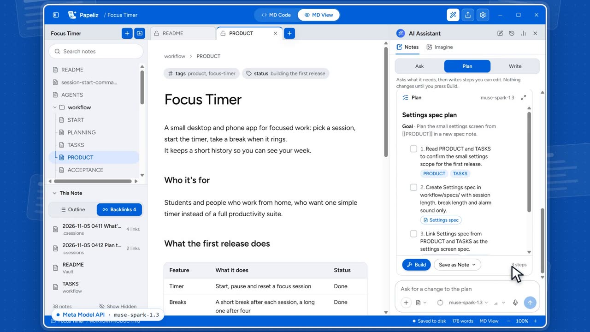<br /><sub><strong>Plan:</strong> a checklist you edit before anything runs.</sub></td>
    <td width="50%">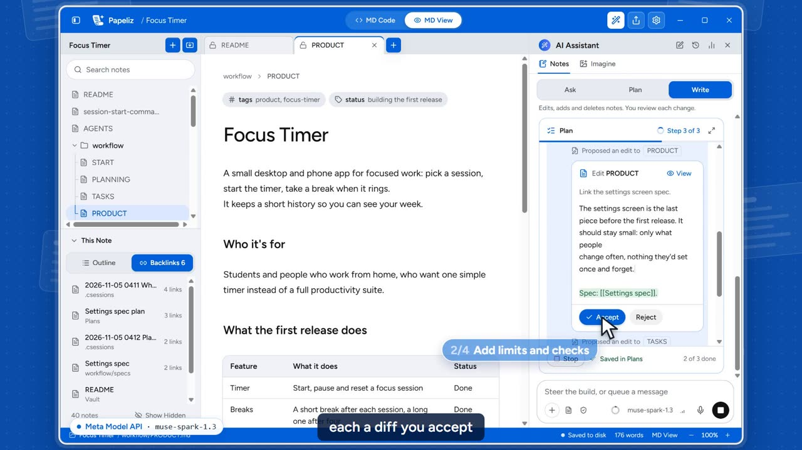<br /><sub><strong>Build:</strong> each step in Write, every change a diff you accept.</sub></td>
  </tr>
  <tr>
    <td width="50%">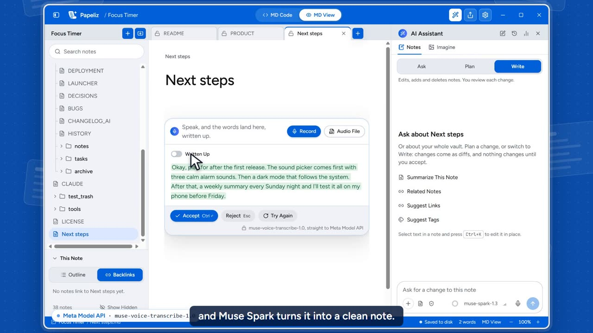<br /><sub><strong>Transcribe Here:</strong> speech to a clean note.</sub></td>
    <td width="50%">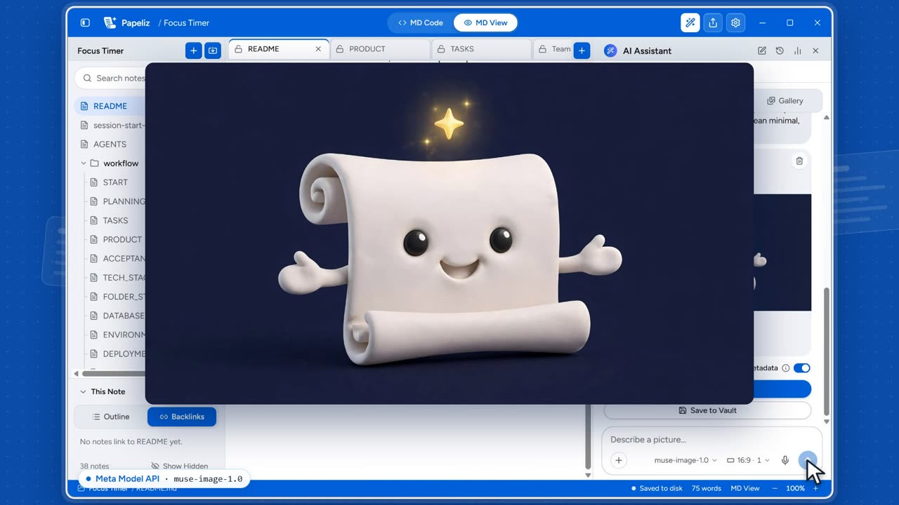<br /><sub><strong>Imagine:</strong> Muse Image draws, and the picture goes in your note.</sub></td>
  </tr>
  <tr>
    <td width="50%">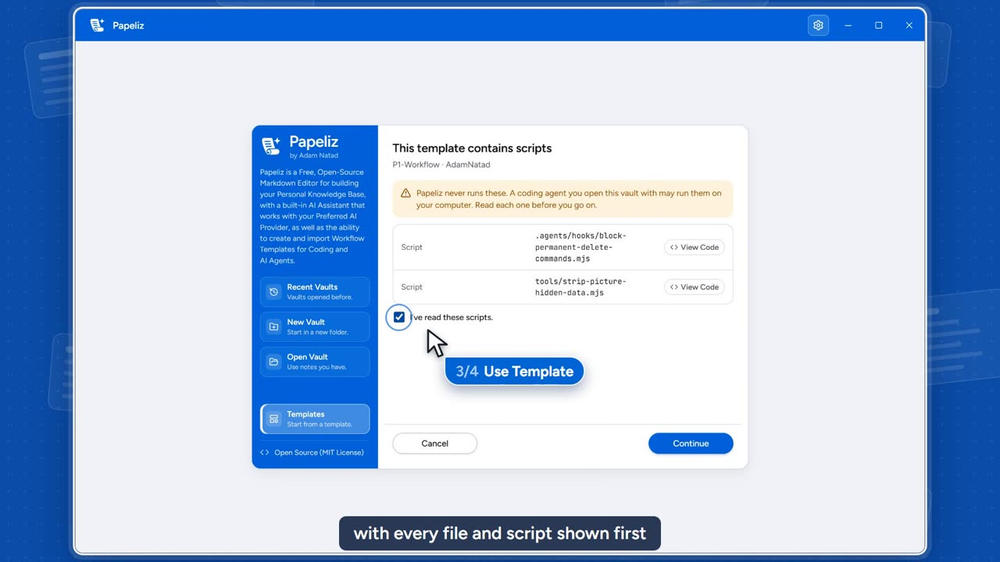<br /><sub><strong>Contains Scripts:</strong> every script shown before the vault is made.</sub></td>
    <td width="50%">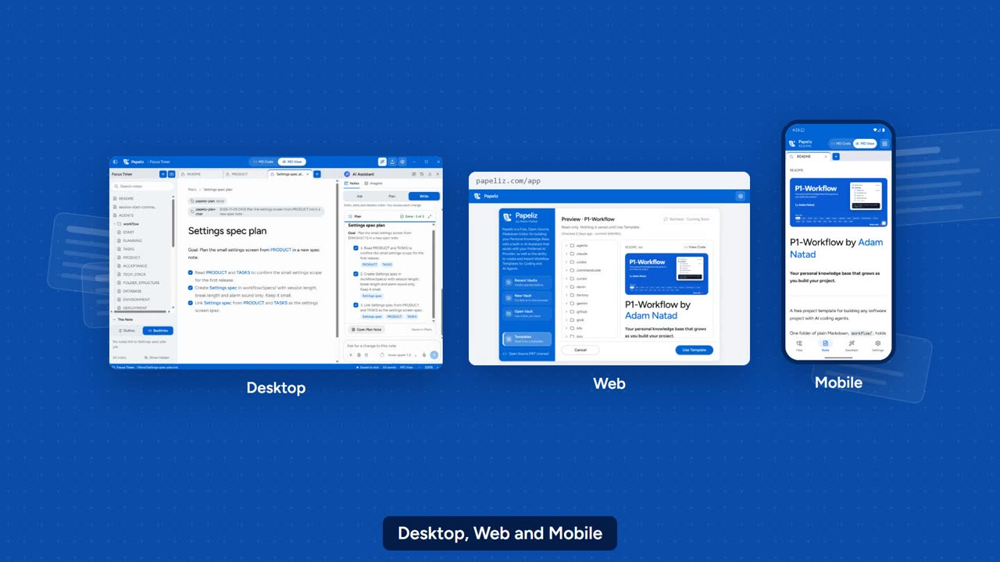<br /><sub><strong>Desktop, web and phone:</strong> one app on each.</sub></td>
  </tr>
</table>

## Built with Meta

Papeliz's AI Assistant is built on the Meta Model API. Every request goes from your browser, or from Papeliz for
Windows or Android, straight to `https://api.meta.ai/v1` with your own key. Papeliz has no server in between.

**One key, one API.** With a single Meta Model API key, Papeliz reads, listens, sees and draws:

- **Muse Spark** reads across a whole vault in its 1,048,576-token context and uses tool calls to look through notes
  and propose changes.
- **Muse Voice Transcribe** lets you talk instead of typing.
- **Muse Image** and **Muse Spark's vision** handle pictures end to end: draw one, edit it, then describe it for its
  alt text.

| Meta model | What it does in Papeliz | Endpoint |
| --- | --- | --- |
| `muse-spark-1.3` | The assistant's Ask, Plan and Write across your whole vault; Rewrite, Shorter, Fix Grammar and Translate on a selection; Suggest Links and Suggest Tags; talking a picture over in Imagine's Ask; writing up a transcript | `POST /v1/chat/completions`, streamed |
| `muse-spark-1.3` (vision) | Describe Picture: alt text for a picture in a note | `POST /v1/chat/completions`, with the picture as `image_url` |
| `muse-voice-transcribe-1.0` | The one-press mic in every assistant box, and Transcribe for recordings and audio files, with speaker labels | `POST /v1/asr/transcribe` |
| `muse-image-1.0` | Imagine's Draw, in the shape you pick; Imagine from a selection in a note | `POST /v1/images/generations` |
| `muse-image-1.0` | Edit Picture: changes a picture in a note as you ask | `POST /v1/images/edits` |

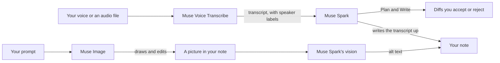

### Beyond a basic integration

- **Three models, chained.** Speech goes to Muse Voice Transcribe and its transcript to Muse Spark, which writes it
  up for the note. A picture Muse Image draws can then be described by Muse Spark's vision.
  [`papeliz-assistant-inline-media-store.ts`](app/web/src/modules/assistant/papeliz-assistant-inline-media-store.ts)
- **Vision for accessibility.** Describe Picture writes a picture's alt text with Muse Spark's vision, as a change to
  accept. [`papeliz-assistant-inline-media-store.ts`](app/web/src/modules/assistant/papeliz-assistant-inline-media-store.ts)
- **About a million tokens of context.** Muse Spark's 1,048,576-token window lets the assistant read across a vault,
  and a ring beside the model chip shows how much is used.
  [`papeliz-assistant-provider-presets.ts`](app/web/src/modules/assistant/papeliz-assistant-provider-presets.ts)
- **A plan built step by step.** Plan writes steps you edit; Build saves them as a checklist note and runs each step
  in Write, as diffs you review, ticking the note as it goes.
  [`papeliz-assistant-plan-document.ts`](app/web/src/modules/assistant/papeliz-assistant-plan-document.ts),
  [`papeliz-assistant-conversation-store.ts`](app/web/src/modules/assistant/papeliz-assistant-conversation-store.ts)
- **A model for each task.** Transcribe and Draw each have their own model, apart from the chat's, with the Meta
  Model API's listed first.
  [`papeliz-assistant-media-model-choices-store.ts`](app/web/src/modules/assistant/papeliz-assistant-media-model-choices-store.ts)

### The agent loop

1. **Plan asks what matters.** Muse Spark asks up to four questions on one card, through its `askUserQuestion` tool,
   and only when they matter.
2. **It writes a checklist you edit.** The plan card's steps are yours to change or tick before anything runs.
3. **Build runs each step in Write.** Build saves the plan as a checklist note in `Plans/`. Then, for each step, Muse
   Spark works through the vault tools, for up to 10 rounds of tool calls:
   - to look: `searchVaultNotes`, `readVaultNote`, `listVaultNoteLinks` and `listVaultNotes`;
   - to propose: `proposeVaultNoteEdit`, `proposeVaultNoteCreate` and `proposeVaultEntriesTrash`.
4. **Every change is a diff you Accept.** A proposal changes nothing until you accept it, unless you switch on Bypass
   permission. Build ticks each step in the plan's note as it finishes, with **Retry Step** and **Skip Step** when a
   step fails, and **Stop** and **Continue**.

The code: the tools in
[`papeliz-assistant-vault-tools.ts`](app/web/src/modules/assistant/papeliz-assistant-vault-tools.ts) and
[`papeliz-assistant-question-tool.ts`](app/web/src/modules/assistant/papeliz-assistant-question-tool.ts); the loop
and its limit, `papelizAssistantMaximumToolRounds`, in
[`papeliz-assistant-conversation-store.ts`](app/web/src/modules/assistant/papeliz-assistant-conversation-store.ts);
the plan's checklist in
[`papeliz-assistant-plan-document.ts`](app/web/src/modules/assistant/papeliz-assistant-plan-document.ts).

Where the calls live:

- [`papeliz-assistant-provider-presets.ts`](app/web/src/modules/assistant/papeliz-assistant-provider-presets.ts):
  the Meta Model API preset, first in the list, with the Muse Spark models.
- [`papeliz-assistant-media-provider-presets.ts`](app/web/src/modules/assistant/papeliz-assistant-media-provider-presets.ts):
  Muse Image's shapes, and Muse Voice Transcribe's audio: 16-bit mono WAV, sent in pieces of under 10 minutes.
- [`papeliz-assistant-image-and-audio-client.ts`](app/web/src/modules/assistant/papeliz-assistant-image-and-audio-client.ts):
  the calls to `/images/generations`, `/images/edits` and `/asr/transcribe`.
- [`papeliz-openai-compatible-client.ts`](app/web/src/modules/assistant/papeliz-openai-compatible-client.ts):
  the streamed calls to `/chat/completions`.

## Benchmarks

The measured latency of each Meta model call, in seconds, from the takes recorded for the demo video on 2026-11-04
and 2026-11-05: one run of each, through the Meta Model API, over a home connection. They change with the network and with how much a request carries, so read
them as examples, not averages.

| What you do | Meta model | Latency |
| --- | --- | --- |
| Ask a question across the vault | Muse Spark 1.3 | First words 4.9 s after Send. The answer, after three calls of 5.45 s, 2.73 s and 6.55 s, is done by 16.9 s |
| Plan asks its questions | Muse Spark 1.3 | 29.6 s |
| Plan lays out its steps, once they're answered | Muse Spark 1.3 | 11.8 s |
| Build's first step, as a diff in Write | Muse Spark 1.3 | 27.7 s |
| Transcribe a 19 s spoken plan | Muse Voice Transcribe 1.0 | 4.44 s |
| Write that transcript up as a clean note | Muse Spark 1.3 | 10.74 s. From Stop to the note ready: 16.8 s |
| The one-press mic, a 7 s request | Muse Voice Transcribe 1.0, then Muse Spark 1.3 | The words in the box about 3 s after Done Speaking. The edit proposed 16.3 s after Send |
| Draw a picture | Muse Image 1.0 | 8.53 s |
| Edit Picture | Muse Image 1.0 | 10.44 s |
| Describe Picture | Muse Spark 1.3 (vision) | 12.3 s |

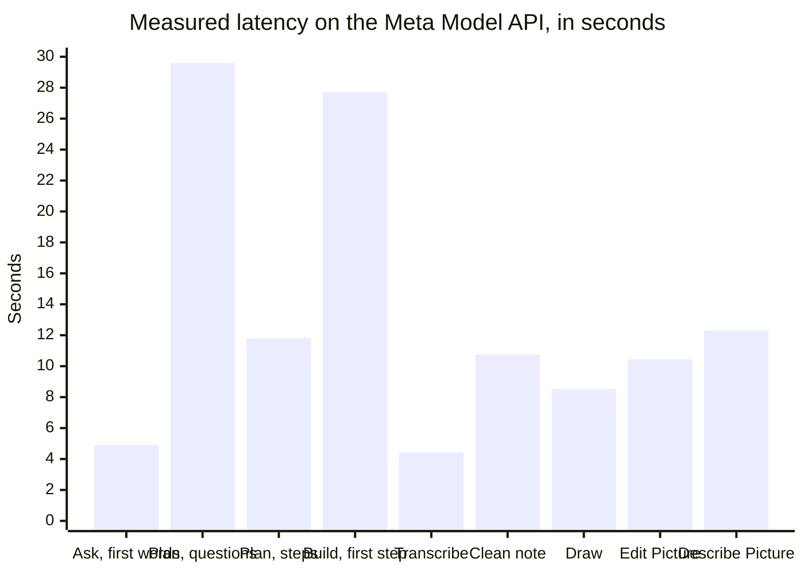

<sub>Single runs from the demo video's recordings, the same latencies as the table above.</sub>

**Cost.** Meta's list prices, from [Pricing and rate limits](https://dev.meta.ai/docs/pricing-rate-limits), read on
2026-11-05:

| Model | Meta's list price |
| --- | --- |
| `muse-spark-1.3` | $1.25 per 1M input tokens, $0.15 per 1M cached input tokens, $4.25 per 1M output tokens |
| `muse-voice-transcribe-1.0` | $0.18 per hour of audio, billed by the second |
| `muse-image-1.0` | $0.01 per generated image |

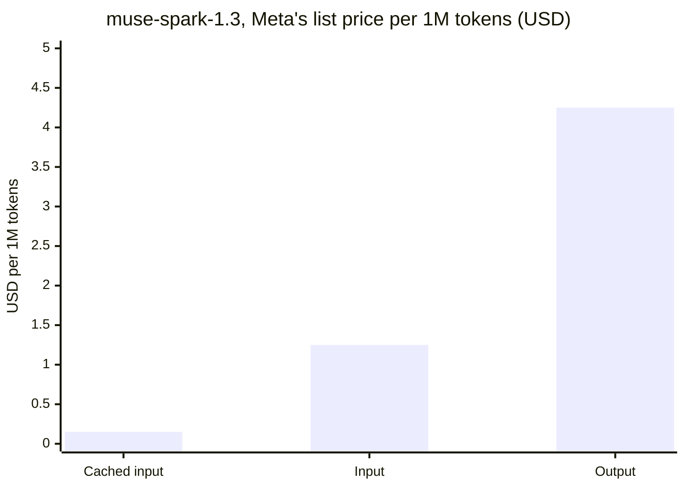

<sub>From [dev.meta.ai/docs/pricing-rate-limits](https://dev.meta.ai/docs/pricing-rate-limits), read on 2026-11-05.</sub>

At those prices, transcribing the demo's 19-second spoken plan costs about $0.001 (19 s × $0.18 per hour), and
drawing one picture costs $0.01. Meta's page doesn't list picture edits separately. In Papeliz, the Usage tab adds up
the assistant's tokens and what they cost at these prices, in total and for each model.

How they were measured:

- **A single call** (Ask's three calls, Transcribe, the clean note, Draw, Edit Picture): the Time column of the
  browser's Network list in its developer tools, saved as a still during the take. The preflight request before each
  call, about 0.2–0.7 s, isn't counted.
- **From a click to the result** (Ask's answer done, Plan, Build, the one-press mic, Describe Picture, Stop to the
  note ready): the recording's own clock, from the click to the moment the recorder saw the result. It looks every
  0.5 s, so these are good to about 0.5 s.
- **Ask's first words:** the first frame of the recording, at 30 frames a second, where the words show.

**One key, every modality.** Through the Meta Model API, one key covers chat, vision, speech to text, picture
generation and picture editing: everything Papeliz uses.

**Tests:** 1,219 unit tests pass, with 1 skipped, and 90 browser tests pass on the two Edge projects, with 2
skipped. How to run them is under [Tests](#tests).

## The pages

| Page | What it is |
| --- | --- |
| [papeliz.com](https://papeliz.com) | The website: what Papeliz is, its features, the AI providers it works with, and the roadmap |
| [papeliz.com/app](https://papeliz.com/app/) | The Papeliz web app. Nothing to install, no sign-up |
| [papeliz.com/help](https://papeliz.com/help/) | Help: 35 guides to the app, with search |
| [papeliz.com/download](https://papeliz.com/download/) | Papeliz for Windows and Android, 1.0.0 Preview 1, the platforms coming soon, and how to install |
| [papeliz.com/templates](https://papeliz.com/templates/) | The Workflow Templates gallery, with a page for each template |
| [papeliz.com/pricing](https://papeliz.com/pricing/) and [/sync](https://papeliz.com/sync/) | Papeliz Sync: what it does, what stays private, and its plans |
| [papeliz.com/changelog](https://papeliz.com/changelog/) | What has changed in Papeliz, newest first |
| [papeliz.com/community](https://papeliz.com/community/) | Where to ask about Papeliz, report a bug or help build it |

## Help and documentation

[papeliz.com/help](https://papeliz.com/help/) has 35 guides to the app, with search, in six groups:

- **[Getting started](https://papeliz.com/help/#getting-started)** (8 guides): what Papeliz is, the sample vault,
  starting or opening a vault (templates included), browser vaults,
  [End-to-end vaults](https://papeliz.com/help/end-to-end-vaults/), browser support, the Settings gear, and Sync.
- **[Writing](https://papeliz.com/help/#writing)** (9 guides): MD Code, MD View, switching views and locking a note,
  links, tags and properties, formatting, find and replace, text settings and theme, backlinks and the outline.
- **[Files](https://papeliz.com/help/#files)** (3 guides): the file list and tabs, renaming, moving and deleting, and
  saving and hidden folders.
- **[The assistant](https://papeliz.com/help/#assistant)** (7 guides): your own key,
  [choosing a provider](https://papeliz.com/help/choose-a-provider/),
  [chatting in Ask, Plan and Write](https://papeliz.com/help/chat-with-the-assistant/),
  [reviewing proposed edits](https://papeliz.com/help/proposed-edits/), editing a selection in place, pictures and
  speech, and focus mode.
- **[Privacy and security](https://papeliz.com/help/#privacy)** (3 guides): where your notes live, where your API key
  goes, and safe rendering.
- **[Reference](https://papeliz.com/help/#reference)** (5 guides): keyboard shortcuts, supported Markdown,
  troubleshooting, Sync's plans, and old versions.

How the code fits together: [docs/how-papeliz-is-built.md](docs/how-papeliz-is-built.md).

## Plans and Pricing

**Papeliz is free, with no account.**

- Every feature of the app, on the web, Windows and Android, free and open source under the MIT License.
- Workflow Templates: browse, Preview, Use Template and Import from Template, with no account.
- The AI Assistant uses your own key with the provider you pick, and Papeliz charges nothing for it.

**Papeliz Sync** keeps your vaults the same on the web, desktop and mobile, with End-to-end encryption for the vaults
you choose. Your phone becomes a window on your agent's work: the vault your coding agents write to on your computer,
there to read and review on your phone. Sync needs a Papeliz account, and its Free plan comes with one. Its plans, as
[papeliz.com/pricing](https://papeliz.com/pricing/) and [papeliz.com/sync](https://papeliz.com/sync/) list them:

| Plan | Price | Storage | Synced vaults | Devices | Largest file | Version history |
| --- | --- | --- | --- | --- | --- | --- |
| Free | Free | 10 MB | 1 | 2 | 5 MB | 7 days |
| Standard | $5 a month, or $48 a year | 10 GB | 5 | 20 | 50 MB | 1 month |
| Plus | $10 a month, or $96 a year | 100 GB | 20 | 20 | 1 GB | 12 months |
| Pro | $20 a month, or $192 a year | 250 GB | 100 | 20 | 2 GB | 12 months |

- Every plan, Free included, offers Standard and End-to-end vaults.
- A paid plan holds up to 100,000, 250,000 or 500,000 files in each vault, and paying yearly costs 20% less than
  paying monthly.
- A paid plan will also let you submit a template to the Papeliz gallery, once submissions open (see
  [Community and Workflows](#community-and-workflows)).

## Community and Workflows

**Workflow Templates** are vaults to start from, shared on GitHub: agent instructions, plans, specs and task lists
for coding and AI agents, or any notes you want others to start from.

| Who | What they can do |
| --- | --- |
| Anyone, free, with no account | Browse **Templates**, **Preview** every file, start a vault with **Use Template**, or add one to the vault you have open with **Import from Template** |
| Anyone, on GitHub | Publish their own template repository and share its link. **Export › Template** makes one from the notes you choose |
| A signed-in Papeliz account | Vote on templates and report one, once votes and reports open |
| A paid Papeliz Sync plan | Submit a template to the Papeliz gallery, once submissions open |

- **Contains Scripts:** a template with scripts or agent commands lists every one, with **View Code**, before
  anything is made. Papeliz never runs them.
- **How to start from one:** [Use a Workflow Template](#use-a-workflow-template), below, and
  [Help: start or open a vault](https://papeliz.com/help/open-a-folder/).
- **Today,** the gallery's list is built into Papeliz. **New**, **Top 100**, votes, **Report** and submitting are
  Coming Soon, with Papeliz's Templates server. **Submit Template** can already **Check** your own repository.

### Use a Workflow Template

1. **Open Templates.** On the start page, choose **Templates**, just above **Synced Vaults**.
2. **Pick one,** such as **P1-Workflow** in **Featured**. Its row shows the author, the license and how many files it
   has.
3. **Preview** shows every file, read-only, and **View Code** beside a file's path shows its text, line by line.
4. **Use Template.** If the template is marked **Contains Scripts**, **This template contains scripts** lists each
   script and each command its agent settings name, with **View Code** beside each. Papeliz never runs them. Tick
   **I've read these scripts**, then choose **Continue**.
5. **Name the new vault,** choose **Folder Storage** or **Browser Storage**, then **Create Vault**. It opens on the
   template's first note.

**Into a vault you already have:** choose **Import** in the file list's header, then **Import from Template**.
**Import into This Vault** puts the template in a new folder named after it, at the top of the vault, and changes
nothing else.

**Make your own:** in **Export**, choose **Export as Template** and set its name, description, tags, first note and
license. Put the files from the `.zip` in a public GitHub repository, and share its link.

<table>
  <tr>
    <td width="50%">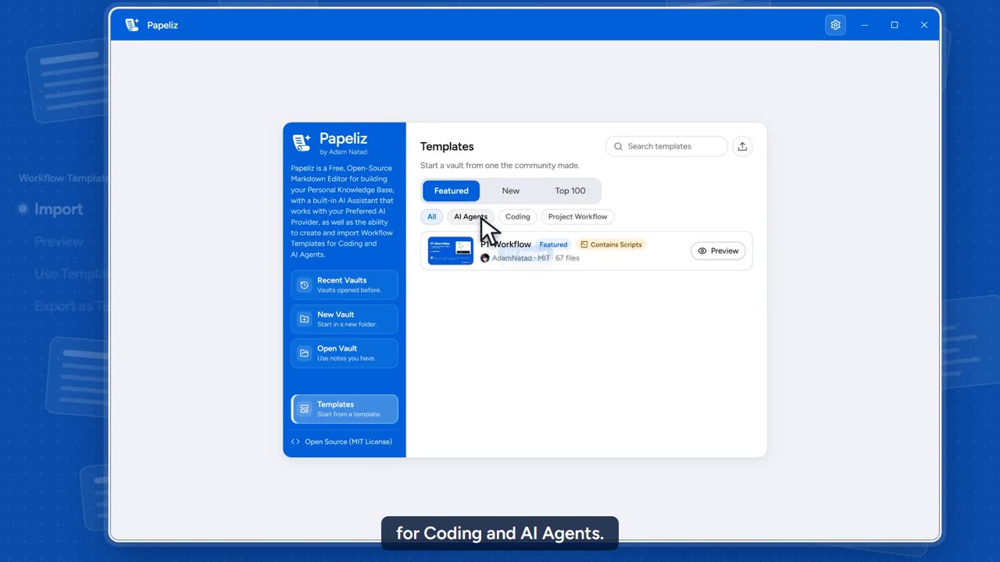<br /><sub><strong>Templates:</strong> pick one from the gallery.</sub></td>
    <td width="50%">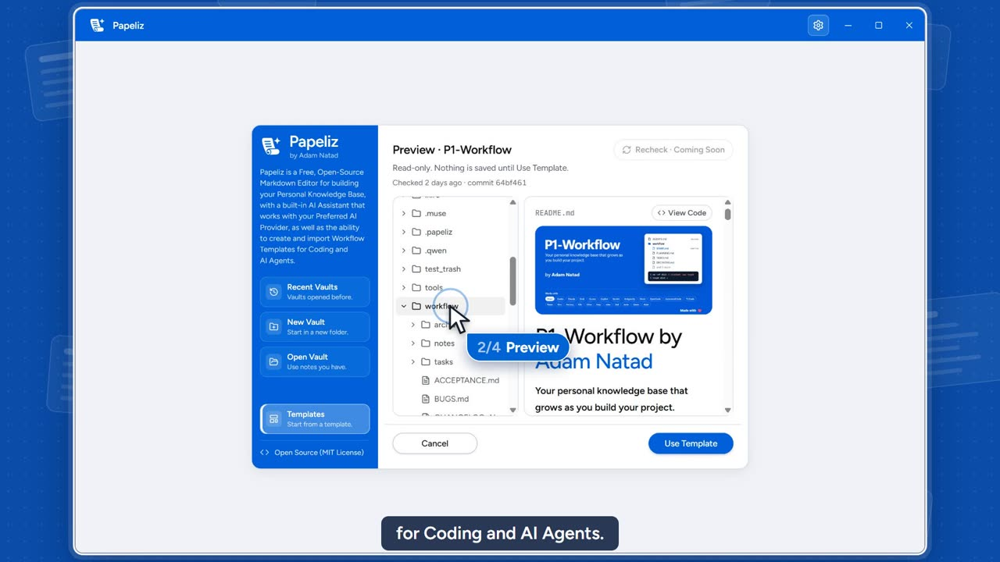<br /><sub><strong>Preview:</strong> every file, read-only, before anything is made.</sub></td>
  </tr>
  <tr>
    <td width="50%"><br /><sub><strong>Contains Scripts:</strong> read each script with View Code.</sub></td>
    <td width="50%">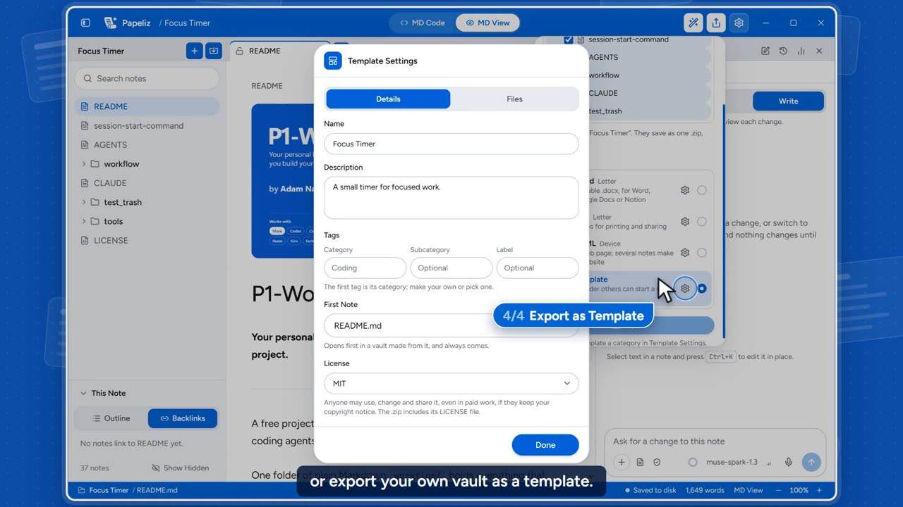<br /><sub><strong>Export as Template:</strong> share your own vault.</sub></td>
  </tr>
</table>

Step by step, in Help: [start or open a vault](https://papeliz.com/help/open-a-folder/) and
[the Settings gear](https://papeliz.com/help/settings-gear/), which covers Export as Template.

**Contributing to Papeliz.** Issues and pull requests are welcome on
[GitHub](https://github.com/AdamNatad/Papeliz/issues): keep notes as plain Markdown, never add a server that sees
users' keys or notes, and contribute only code you have the right to share under the MIT License. To ask a question
or share how you use Papeliz, see [papeliz.com/community](https://papeliz.com/community/).

## Run it locally

You need [Node.js](https://nodejs.org) 24 LTS and [pnpm](https://pnpm.io) (the version in `package.json`,
`packageManager`; `corepack enable` sets it up).

```bash
pnpm install
pnpm webapp:dev
```

The app opens at `http://127.0.0.1:14201`. The `webapp:*`, `site:*` and `help:*` scripts build, test, lint and
type-check each piece.

## Code layout

| Folder | What it holds |
| --- | --- |
| [`app/web/`](app/web/) | The Papeliz app, in React and TypeScript: the editor, vaults, Export, Templates and the AI Assistant, with the Meta Model API calls in `src/modules/assistant/`. Unit tests sit beside the code, and the browser tests are in `browser-tests/`. |
| [`app/desktop/`](app/desktop/) | Papeliz for Windows: the same app in a small native shell, and its installer. |
| [`app/mobile/`](app/mobile/) | Papeliz for Android: the same app in a small native shell, with its phone layout. |
| [`app/html-export-astro-site/`](app/html-export-astro-site/) | The website project that HTML Export puts beside an exported website, to restyle it and build it again. |
| [`site/main/`](site/main/) | The website at papeliz.com, exported as static pages. |
| [`site/help/`](site/help/) | The Help guides at papeliz.com/help. |
| [`build_tools/`](build_tools/) | Launchers that start and build each piece on Windows, macOS and Linux, and shared tools such as the picture-metadata strip. |
| [`docs/`](docs/) | How Papeliz is built, and the pictures in this README. |
| [`branding/`](branding/) | The logo and the social banner. |

## Configuration

The AI Assistant is set up in the app, under the gear's **AI Provider**.

- **The Meta Model API** is the first preset. Paste your key from the [Model API dashboard](https://dev.meta.ai/) and
  pick a Muse Spark model.
- **Transcribe and Draw** each have their own model choice, with the Meta Model API's models listed first.
- **Other providers:** Papeliz speaks the OpenAI-compatible API format, so one connection works with many providers.
  Pick a preset or enter any compatible URL, paste your key, choose a model, and test it.

| Kind | Providers |
| --- | --- |
| Hosted | OpenAI, OpenRouter, Groq, Together, Fireworks, Google Gemini (OpenAI-compatible endpoint) |
| On your computer | Ollama, LM Studio (allow `https://papeliz.com` in their browser settings) |
| Anything else | Custom base URL for any OpenAI-compatible API |

Your key is stored only on your device and is sent only to the provider you picked. Step by step:
[Help: choose a provider](https://papeliz.com/help/choose-a-provider/) and
[where your API key goes](https://papeliz.com/help/where-your-key-goes/).

## Deploying

The app, the website and Help are static files, so any static host can serve them.

```bash
pnpm deploy:assemble
```

This builds the website, the app and Help, then puts them in one folder, `deploy/`, for one domain:

| Path | What it serves | Built from |
| --- | --- | --- |
| `/` | The website | `site/main/out` |
| `/app/` | The app | `app/web/dist/app` |
| `/help/` | Help | `site/help/out` |

- **Headers:** the app's build also writes `app/web/dist/_headers`, with the Content-Security-Policy for every file
  under `/app/`. Give `/app/` the same headers on your host, so the app's background workers get the policy too.
- **An earlier `deploy/` folder** goes to the Recycle Bin or Trash through the `trash` command. If that command is
  missing, the old folder is kept and the build stops.

## Tests

| Tests | Command | Last run |
| --- | --- | --- |
| The app's unit tests | `pnpm webapp:test` | 1,219 passed and 1 skipped, in 148 files, on 2026-11-05 |
| The app's browser tests, in Edge | `pnpm webapp:browser-test --project=msedge --project=msedge-desktop` | 90 passed and 2 skipped, in 6 minutes, on 2026-11-05 |
| The website's tests | `pnpm site:test` | 97 passed, on 2026-11-05 |

- **The browser tests** start their own copy of the app and run it in the Edge installed on your computer, in a fresh
  profile. `msedge-desktop` runs it as Papeliz for Windows builds it.
- **`pnpm webapp:browser-test` on its own** also runs the Firefox and WebKit projects, which need those browsers
  installed for the test runner first.
- **Type checks and lint:** `pnpm webapp:typecheck` and `pnpm webapp:lint`, and the same for `site:` and `help:`.

## Technical notes

### How it's built

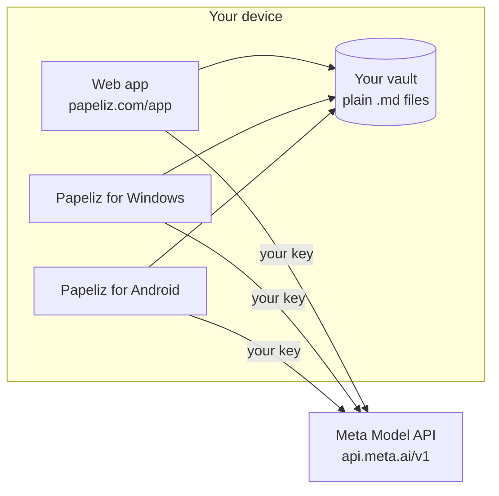

- **One app everywhere.** The web app is React and TypeScript. Papeliz for Windows and Android run the same app in a
  small native shell, so every platform shares one codebase.
- **No Papeliz server.** papeliz.com is static files. Requests go straight from the device to the provider, with the
  person's own key.
- **The Meta Model API's own shapes.** Streamed chat on `/chat/completions`, speech on the multipart
  `/asr/transcribe`, and pictures on `/images/generations` and `/images/edits`. Audio is turned into WAV on the
  device and sent in pieces.
- **Diffs, not overwrites.** Every model edit is a proposal you accept. The same note open twice merges line by line,
  and a clash asks what to keep.
- **Tested.** 1,219 unit tests and 90 browser tests, as of 2026-11-05.

How the pieces fit together: [docs/how-papeliz-is-built.md](docs/how-papeliz-is-built.md).

### Privacy and security

- **No Papeliz server.** papeliz.com is served as static files, with no code running on a server: no backend, no
  account, no analytics on your notes.
- **Notes stay on your device.** Papeliz reads and writes the folder you open (on the web, through the File System
  Access API). It never writes inside a vault's hidden folders, and deleted notes go to the vault's `.trash/` folder.
- **You choose what the assistant sees.** Each message shows which notes are shared with your provider, and nothing
  is sent until you send it.
- **Safe rendering.** Notes are sanitized before display, and the app ships a strict Content-Security-Policy, so a
  note can't run code in the page that holds your keys.

### Accessibility

- **Tagged PDFs.** PDF export writes tagged PDFs, with searchable text, working links and headings as bookmarks. On
  2026-10-31, 51 exported PDFs passed every PDF/UA-1 rule of an automated validator except the PDF/UA-1 claim itself,
  which stays off until a screen-reader read-through.
  [`papeliz-pdf-export-file-writer.ts`](app/web/src/modules/pdf-export/papeliz-pdf-export-file-writer.ts)
- **Alt text.** Describe Picture writes a picture's alt text with Muse Spark's vision, as a change you accept.
- **Keyboard.** `Ctrl+K` edits a selection with the assistant, `Ctrl+Enter` accepts the edit, and `Ctrl+Shift+F`
  turns focus mode on or off. Every shortcut is in Help's
  [Keyboard shortcuts](https://papeliz.com/help/keyboard-shortcuts/).
- **Reduced motion.** With your system set to reduce motion, the app's sliding switches, the assistant panel's tab
  underline and the mic's sound-level line stop moving.

## FAQ

**Do I need an account?** No. The web app, Papeliz for Windows and Papeliz for Android need no account and no
sign-up. Only Papeliz Sync needs a Papeliz account.

**Where are my notes kept?** On your device, never on a Papeliz server: in a folder of `.md` files you open, or in a
vault kept in the browser, which you can download as a `.zip`. Saved chats are notes too, in the vault's hidden
`.csessions` folder.

**Does Papeliz see my API key?** No. Your key is stored only on your device and goes straight from it to the provider
you picked. Papeliz has no server in between.

**Which AI providers work?** The Meta Model API is the first preset. Any OpenAI-compatible API works too, hosted or on
your own computer: see [Configuration](#configuration).

**Is it free?** Yes. Every feature is free and open source under the MIT License, and Papeliz charges nothing for the
AI Assistant. Papeliz Sync has a Free plan and paid plans: see [Plans and Pricing](#plans-and-pricing).

**What was built during the hackathon?** All of it, from 27 October to 4 November 2026 (US Eastern Time, the event's
own window): the web app and the AI
Assistant first, then Plan and Write, Export, Workflow Templates, Transcribe Here, Imagine, End-to-End Encrypted
vaults and the Windows and Android apps. The [changelog](CHANGELOG.md) has each day.

## Roadmap

**Available now**

- [x] Folder vaults, browser vaults and End-to-end vaults
- [x] MD Code and MD View, tables, Mermaid diagrams, pictures and video
- [x] Export as Word, PDF, HTML and Template
- [x] The assistant's Ask, Plan and Write on Muse Spark, with every edit a diff
- [x] Imagine, Edit Picture and Describe Picture with Muse Image and Muse Spark's vision
- [x] The one-press mic and Transcribe with Muse Voice Transcribe
- [x] Workflow Templates, with every script shown before the vault is made

**Up next: Papeliz Sync**

- [ ] Keep your vaults in sync across web, desktop and mobile, with End-to-end encryption for the vaults you choose

**Later**

- [ ] Graph view and canvas
- [ ] Translations
- [ ] Math and code highlighting in MD View

## Built with

| Project | Used for | License |
| --- | --- | --- |
| [Vite](https://vite.dev) | Build and dev server | MIT |
| [React](https://react.dev) | User interface | MIT |
| [TypeScript](https://www.typescriptlang.org) | Language | Apache-2.0 |
| [Tailwind CSS](https://tailwindcss.com) | Styling | MIT |
| [CodeMirror](https://codemirror.net) | MD Code | MIT |
| [unified](https://unifiedjs.com) (remark, rehype) | Parsing and rendering Markdown | MIT |
| [Mermaid](https://mermaid.js.org) | Diagrams in MD View | MIT |
| [docx](https://docx.js.org) | Word export | MIT |
| [PDFKit](https://pdfkit.org) | PDF export | MIT |
| [bidi-js](https://github.com/lojjic/bidi-js) | Right-to-left text in PDFs | MIT |
| [MiniSearch](https://lucaong.github.io/minisearch/) | Full-text search | MIT |
| [zustand](https://zustand.docs.pmnd.rs) | App state | MIT |
| [Lucide](https://lucide.dev) | Icons | ISC |
| [Next.js](https://nextjs.org) | The website and help site (static export) | MIT |
| [Figtree](https://fonts.google.com/specimen/Figtree) via [Fontsource](https://fontsource.org) | Typeface | OFL-1.1 |
| [Charis SIL](https://software.sil.org/charis/) and [Noto Sans](https://fonts.google.com/noto/specimen/Noto+Sans) via Fontsource | Serif notes and other scripts in PDFs | OFL-1.1 |

Hosted on [Cloudflare Workers](https://workers.cloudflare.com) static assets.

## Team and acknowledgements

- **[Adam Natad](https://papeliz.com/adam-natad/)** made Papeliz, for [Natad Corporation](https://natad.ai/).
- **Built on the Meta Model API,** with Muse Spark, Muse Voice Transcribe and Muse Image, for the **Meta Global AI
  Developer Hackathon 2026**.
- **Thanks to the open-source projects** under [Built with](#built-with), whose work Papeliz stands on.

## License

---

<p align="center">Made with ❤️ by <a href="https://papeliz.com/adam-natad/">Adam Natad</a>.</p>

<p align="center">Copyright © 2026 <a href="https://natad.ai/">Natad Corporation</a>.</p>

<p align="center"><a href="LICENSE">MIT License</a>.</p>
