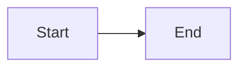

# Code blocks

A short block:

```js
console.log('one line')
```

A block with tabs and blank lines:

```py
def total(numbers):
	result = 0

	for number in numbers:
		result += number
	return result
```

A block with a very long line that has to wrap at the edge of the box, because paper can't scroll sideways the way a page on screen can:

```text
https://example.com/a/very/long/address/that/keeps/going/and/going/without/any/spaces/in/it/at/all/until/the/end
```

A block longer than twelve lines, which may break across pages:

```
line 1
line 2
line 3
line 4
line 5
line 6
line 7
line 8
line 9
line 10
line 11
line 12
line 13
line 14
```

An empty block:

```
```

A diagram, shown as its source until diagrams arrive:


