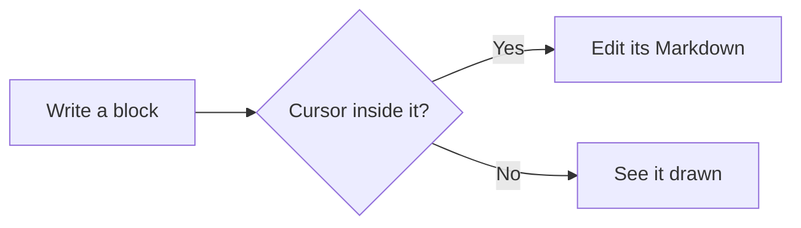
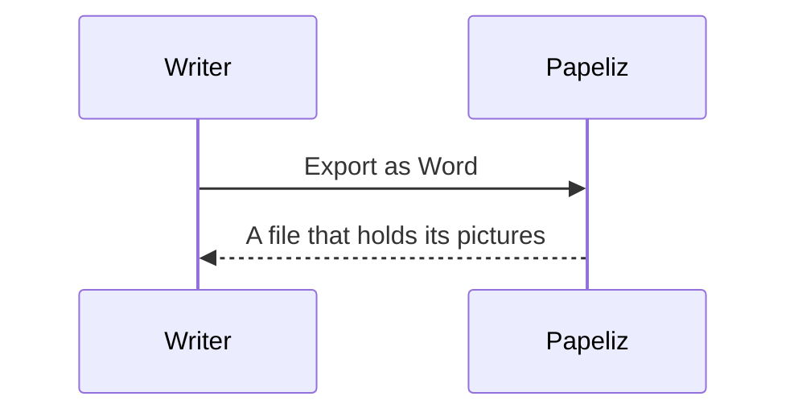

# Pictures and diagrams

A picture kept in the vault, by its path:


A wide photo, made smaller to fit the page:


A tall picture, made smaller to fit one page:


The same plan embedded by name, then given a width:

![[garden-plan.png]]

![[garden-plan.png|120]]

A drawing kept as SVG:  in a line of text.

- A list item with a picture: 

A picture from the web, and one whose site doesn't let other pages read it:


A picture the vault has but can't be read, and one the vault doesn't have:


| Picture | What it shows |
| --- | --- |
|  | The icon, in a table |

A flowchart:



A sequence diagram:



A diagram with a mistake, shown as its source:

```mermaid
flowchart LR
  A -->
```
